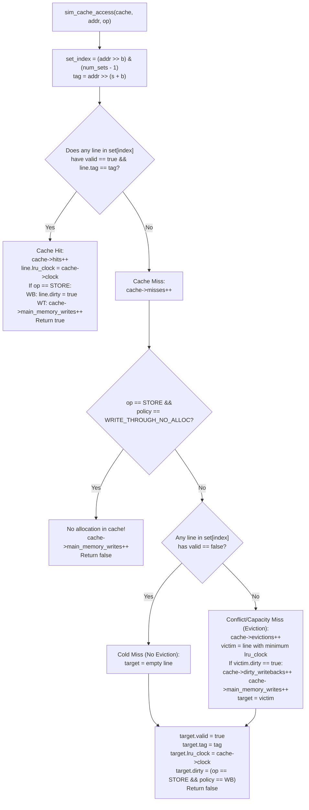

# Concepts: LRU Cache State Machine & Write Policies

## Cache Access State Machine

## Write Policies

### Policy 1: Write-Back + Write-Allocate (`WRITE_BACK_ALLOCATE`)
- Used by real x86-64 and ARM CPUs (and simulated by Cachegrind).
- On write hit: Sets `line.dirty = true`. RAM is NOT touched.
- On write miss: Allocates a line in cache (loading the block), writes data into SRAM, sets `dirty = true`.
- Dirty Write-Back: When a dirty line is evicted by an LRU replacement, `dirty_writebacks++` and `main_memory_writes++` increment to flush the modified block to DRAM.

### Policy 2: Write-Through + No-Write-Allocate (`WRITE_THROUGH_NO_ALLOC`)
- On write hit: Updates cache line AND immediately updates DRAM (`main_memory_writes++`).
- On write miss: Writes directly to DRAM (`main_memory_writes++`) without allocating a cache line.
- Dirty bit is never used because cache and DRAM remain synchronized at all times.

---

# Task: Implement Cache Access State Machine

- Target File: [05_lru_cache_sim.c](file:///Users/bradleyyeo/Documents/learn/csapp3e-brad/csi/01-computer-architecture/06-memory-hierarchy-caching/05_lru_cache_sim.c)
- Shared Types: Defined in [cache_sim.h](file:///Users/bradleyyeo/Documents/learn/csapp3e-brad/csi/01-computer-architecture/06-memory-hierarchy-caching/cache_sim.h)

## Architectural Implementation Guidelines

- Scan all $E$ lines for a tag match first. If you stop at the first invalid line before checking all ways, you risk allocating a duplicate line for an address already resident.
- Use `cache->clock` (incremented monotonically on every access) as the LRU timestamp.
- On eviction, find the line in `set[0 .. E-1]` with the strictly minimum `lru_clock`.
- Wrap `main()` in `#ifndef NO_MAIN` so subsequent exercises (`06_conflict_misses`, `07_matmul_loop_orders`, `09_tiling`) can link against your simulator object directly.

---

# Predict Before Running

- Direct-mapped $(s=4, E=1, b=4)$ on `yi.trace`:
  - 4 hits, 5 misses, 3 evictions, 1 dirty writeback, 1 main memory write.
- 2-Way Set-Associative $(s=2, E=2, b=4)$:
  - Access 1 (`0x000`): Miss (clk 1)
  - Access 2 (`0x040`): Miss (clk 2)
  - Access 3 (`0x000`): Hit (clk 3, refreshes Way 0)
  - Access 4 (`0x080`): Miss + Evicts Way 1 (clk 2)
  - Access 5 (`0x000`): Hit (Way 0 still resident!)
  - Access 6 (`0x040`): Miss (Way 1 was evicted)

---

# Active Recall Checkpoints

- Why must an LRU cache update `lru_clock` on cache hits as well as cache misses?
- In a write-back cache, under what exact conditions does an eviction cause an off-chip DRAM write?
- How does `sim_cache_access` directly map to the `cache_access` function required in CS:APP Cache Lab `csim.c`?

---

# Navigation Links

- Next Exercise: [06_conflict_misses.md](file:///Users/bradleyyeo/Documents/learn/csapp3e-brad/csi/01-computer-architecture/06-memory-hierarchy-caching/06_conflict_misses.md)
- Reference Solution: [reference-solution/05_lru_cache_sim.c](file:///Users/bradleyyeo/Documents/learn/csapp3e-brad/csi/01-computer-architecture/06-memory-hierarchy-caching/reference-solution/05_lru_cache_sim.c)
