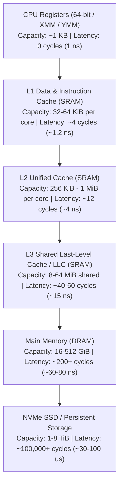
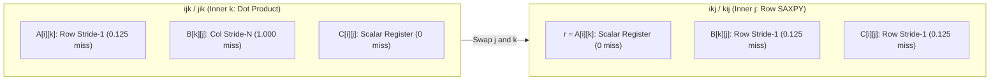

# Curriculum Context and Knowledge Connections

## How This Module Connects to Your Existing Notes

- Pointer Stride Scaling: In [08_pointer_arithmetic_strides.md](file:///Users/bradleyyeo/Documents/learn/csapp3e-brad/exercises/08_pointer_arithmetic_strides.md), you established that advancing a typed pointer `T *p` by `n` steps scales the byte address by `n * sizeof(T)`, and that 2D row-major arrays map $(r, c)$ to $\text{Base} + (r \times \text{cols} + c) \times \text{sizeof}(T)$. Here you will see how hardware cache controllers physically react to those byte strides.
- Power-of-Two Bitwise Masks: In [11_bump_allocator.md](file:///Users/bradleyyeo/Documents/learn/csapp3e-brad/exercises/11_bump_allocator.md), you used `(addr + (a - 1)) & ~(a - 1)` to align addresses to power-of-two boundaries. Hardware caches partition 64-bit physical addresses using the exact same power-of-two bitmask algebra (`offset`, `set_index`, `tag`).
- Superscalar Pipelining and Accumulators: In [19_pipelining_hazards.md](file:///Users/bradleyyeo/Documents/learn/csapp3e-brad/exercises/19_pipelining_hazards.md) and [05-low-level-optimization/README.md](file:///Users/bradleyyeo/Documents/learn/csapp3e-brad/csi/01-computer-architecture/05-low-level-optimization/README.md), you broke Read-After-Write (RAW) latency chains using loop unrolling and $4 \times 4$ accumulators. However, arithmetic unit parallelism is useless if the Load/Store Unit stalls for $200$ cycles waiting on DRAM.
- Valgrind Instrumentation: In [06_valgrind_fundamentals.md](file:///Users/bradleyyeo/Documents/learn/csapp3e-brad/exercises/06_valgrind_fundamentals.md), you studied how Valgrind translates machine code into VEX IR. Valgrind's `cachegrind` tool uses this same VEX IR stream to intercept every instruction fetch, data load, and data store to simulate an L1/LL cache hierarchy.
- CS:APP Cache Lab Integration: In [labs/05_cachelab/CONCEPTS.md](file:///Users/bradleyyeo/Documents/learn/csapp3e-brad/labs/05_cachelab/CONCEPTS.md), you are building a trace-driven simulator ([csim.c](file:///Users/bradleyyeo/Documents/learn/csapp3e-brad/labs/05_cachelab/cachelab-handout/csim.c)) and optimizing $32 \times 32$ and $64 \times 64$ matrix transpositions ([trans.c](file:///Users/bradleyyeo/Documents/learn/csapp3e-brad/labs/05_cachelab/cachelab-handout/trans.c)). The exercises in this directory build the foundational mental models and quantitative miss-prediction skills needed for both tasks.

---

# Software Design Principles in Hardware Caching

## John Ousterhout: Deep Modules

- Transparent Hardware Interface: A CPU cache is one of the deepest modules in computer architecture. Its external interface has zero new instructions for normal user code—`movq (%rdi), %rax` uses the exact same virtual address whether the data sits in L1 cache or DRAM.
- Encapsulated Mechanism: Behind that zero-surface interface, the cache controller manages address tag decoding, multi-way parallel comparator banks, dirty-bit write-back queues, Miss Status Holding Registers (MSHRs), and hardware stream prefetchers.

## Daniel Jackson: Concept Decomposition

- Concept 1 — Spatial Block Transfer (`CacheLine`): Memory is never transferred between DRAM and SRAM as isolated bytes; it moves in fixed-size aligned blocks of $B = 2^b$ bytes (64 bytes on modern x86-64 and ARM64).
- Concept 2 — Modulo Set Partitioning (`CacheSet`): The $S = 2^s$ sets partition the address space via middle bits so adjacent $B$-byte blocks distribute uniformly across independent SRAM rows.
- Concept 3 — Associative Way Lookup (`CacheWay`): Within a selected set, $E$ parallel lines allow up to $E$ distinct memory blocks with the same set index to coexist without evicting one another.
- Concept 4 — Replacement Policy (`LRUState`): When all $E$ ways in a set are valid and a new block maps to that set, a deterministic policy (Least Recently Used) selects the victim line.

## Jimmy Koppel: Single Authority and Representation Invariants

- Single Authority for Block Identity: Because the set index $s$ and block offset $b$ are implicit in the physical location within the cache array (`sets[index]`), only the upper $t = m - (s + b)$ tag bits are stored in `line.tag`. The tuple `(set_index, line.tag)` is the single authority identifying which $B$-byte main memory block occupies the line.
- Validity Invariant: Uninitialized SRAM cells contain arbitrary voltage states (`tag == 0` can match physical address `0x0`). A line contains meaningful data if and only if `line.valid == true`.
- Dirty Invariant (Write-Back Caches): Main memory is stale relative to a cache line if and only if `line.valid == true && line.dirty == true`. Evicting a dirty line requires an explicit write-back transaction to lower memory before overwriting the line.

---

# The Memory Wall and Storage Hierarchy

## Latency and Capacity Tradeoffs Across Tiers



## Physical Origin of the Latency Hierarchy

### Static RAM (SRAM — L1, L2, L3 Caches)

- Constructed from 6-transistor (6T) bistable flip-flop latches per bit.
- Holds state indefinitely as long as power is supplied; requires no refresh cycles.
- Fast switching speeds ($1\text{--}15\text{ ns}$), but low density and high power/silicon area cost.

### Dynamic RAM (DRAM — Main Memory)

- Constructed from 1 capacitor and 1 access transistor (1T1C) per bit.
- High density ($10\times\text{--}20\times$ denser than SRAM), but reading discharges the capacitor (destructive read requiring immediate sense-amplifier rewrite) and charge leaks within milliseconds (requiring periodic refresh stalls).
- Wire length and off-chip bus serialization impose a $\sim 200$-cycle latency wall.

---

# Hardware Cache Geometry and Bitwise Address Decoding

## The $(S, E, B, m)$ Tuple

- $m$: Total bits in a physical memory address ($m = 64$ on x86-64).
- $s$: Number of set index bits, yielding $S = 2^s$ sets.
- $E$: Number of lines (ways) per set.
- $b$: Number of block offset bits, yielding $B = 2^b$ bytes per cache block (cache line).
- $t = m - (s + b)$: Number of tag bits stored in each cache line's metadata.
- Total usable data capacity $C$:
  $$C = S \times E \times B = 2^{s + b} \times E \text{ bytes}$$

## Bitwise Extraction Formula

```
63                      s + b               b                   0
+-----------------------+-------------------+-------------------+
|      Tag (t bits)     | Set Index (s bits)| Block Offset (b)  |
+-----------------------+-------------------+-------------------+
```

```c
uint64_t offset    = addr & ((1ULL << b) - 1);
uint64_t set_index = (addr >> b) & ((1ULL << s) - 1);
uint64_t tag       = addr >> (s + b);
```

## Why Set Index Uses Middle Bits Instead of High Bits

### Flawed High-Bit Indexing

- Suppose the highest $s$ bits selected the cache set.
- Every contiguous region of $2^{m - s}$ bytes would share identical high bits and map to a single cache set, leaving the other $S - 1$ sets completely unused.

### Standard Middle-Bit Indexing

- Placing the set index in bits $[b \dots s+b-1]$ means advancing an address by $B$ bytes increments `set_index` by $1 \pmod S$.
- Any contiguous array of size $S \times B$ bytes maps across all $S$ sets with zero set collisions.

---

# Principle of Locality and Quantitative Miss Rate Algebra

## Spatial vs Temporal Locality

### Temporal Locality

- A memory address referenced once is likely to be referenced again in the near future.
- Example: Loop accumulator `sum` or outer-loop matrix element `A[i][k]` held in a register or L1 cache line across inner loop iterations.

### Spatial Locality

- If a memory address `addr` is referenced, nearby addresses within `[addr & ~(B - 1), (addr & ~(B - 1)) + B)` are likely to be referenced soon.
- Example: Scanning `int x[4000][4000]` in row-major order loads $B = 64$ bytes (16 four-byte `int`s) on the first miss (`x[i][0]`), turning the next 15 accesses (`x[i][1..15]`) into L1 hits.

## Stride-k Miss Rate Formula

- Let element size be $w = \text{sizeof}(T)$ bytes, cache block size be $B$ bytes, and loop step be $\text{Stride} = k$ elements ($k \times w$ bytes per step).
- Elements per cache line:
  $$L = \frac{B}{w}$$
- When scanning a large array exceeding cache capacity:
  $$\text{Miss Rate}(\text{Stride } k) = \min\left(1.0, \frac{k \times w}{B}\right) = \min\left(1.0, \frac{k}{L}\right)$$
- Once $k \times w \ge B$ (e.g., jumping down a column where $N \times w \ge 64$ bytes and row count exceeds cache lines), every single access touches a different cache line and evicts prior lines before reuse, yielding a $100\%$ miss rate.

## Analytical Walkthrough of `loop-order.c`

### `option_one`: Row-Major `x[4000][4000]` (`x[i][j]`)

- Total writes: $4000 \times 4000 = 16,000,000$ writes of 4-byte `int`s.
- Byte stride between `x[i][j]` and `x[i][j+1]`: $4$ bytes (Stride-1).
- Cache line size $B = 64$ bytes holds $L = 64 / 4 = 16$ integers.
- Predicted L1 write misses:
  $$\frac{16,000,000}{16} = 1,000,000 \text{ misses } (6.25\% \text{ miss rate})$$

### `option_two`: Column-Major `x[4000][4000]` (`x[j][i]`)

- Total writes: $16,000,000$.
- Byte stride between `x[j][i]` and `x[j+1][i]`: $4000 \times 4 = 16,000$ bytes (Stride-4000).
- Since $16,000 \text{ B} \gg 64 \text{ B}$ and $4000$ rows $\times 64 \text{ B} = 256 \text{ KiB} \gg 32\text{--}64 \text{ KiB}$ L1d capacity, every cache line loaded for `x[j][i]` is evicted before the outer loop increments `i` to access `x[j][i+1]`.
- Predicted L1 write misses:
  $$16,000,000 \text{ misses } (100\% \text{ miss rate})$$

### `option_five`: Narrow Column-Major `x[4000][8]` (`x[j][i]`)

- Array geometry: $4000$ rows $\times 8$ columns $= 32,000$ integers ($128,000$ bytes).
- Row width: $8 \times 4 = 32$ bytes.
- Because a cache line is $B = 64$ bytes, **each 64-byte cache line holds 2 consecutive rows** (`Row 2k` and `Row 2k+1`).
- In the inner loop (`j = 0..3999`), incrementing `j` from `2k` to `2k+1` steps by $32$ bytes, landing inside the **same 64-byte cache line** just loaded for `Row 2k`!
- However, by the time `j` finishes all $4000$ rows ($128 \text{ KiB} > 64 \text{ KiB}$ L1d cache), early lines have been evicted, so the next outer iteration `i + 1` misses again on `Row 2k` and hits on `Row 2k+1`.
- Predicted L1 write misses:
  $$\frac{32,000}{2} = 16,000 \text{ misses } (50\% \text{ miss rate})$$

---

# Write Policies and Dirty-Bit Lifecycle

## Write Hit Policies

### Write-Through

- Every store instruction updates both the cache line and the next lower memory level immediately.
- Advantage: Simpler hardware; lower memory is always consistent.
- Disadvantage: Generates high memory bus traffic on repeated stores to the same variable.

### Write-Back

- Store instructions update only the L1 cache line and set `line.dirty = true`.
- Modified data is written back to lower memory **only when the dirty line is evicted**.
- Advantage: Absorbs repeated writes (e.g., loop counters, stack pushes, `C[i][j]` accumulations) entirely inside L1 SRAM with zero external bus traffic.

## Write Miss Policies

### Write-Allocate (Fetch-on-Write)

- On a store miss, the cache loads the target $B$-byte block from lower memory into a cache line first, then performs the write-hit update.
- Standard pairing: **Write-Back + Write-Allocate** (used by L1/L2/L3 caches in modern x86-64 and ARM64 CPUs, and simulated by Valgrind Cachegrind).

### No-Write-Allocate (Write-Around)

- On a store miss, the cache bypasses SRAM allocation and writes directly to lower memory.
- Standard pairing: **Write-Through + No-Write-Allocate**.

---

# The 3 Cs of Cache Misses and Power-of-Two Conflict Thrashing

## Classification of Cache Misses

### Compulsory (Cold) Misses

- Inevitable misses incurred the very first time a memory block is referenced.
- Independent of cache capacity $C$ or associativity $E$; reduced only by increasing block size $B$ or prefetching.

### Capacity Misses

- Occur when the active working set of a loop exceeds total cache capacity $C = S \times E \times B$, even under full associativity ($S = 1, E = C/B$).
- Solved by **Cache Blocking / Tiling**, which partitions loops into sub-blocks whose working set fits inside $C$.

### Conflict Misses

- Occur when total cache capacity $C$ is large enough to hold the working set, but multiple active variables map to the **exact same Set Index** more than $E$ times.

## Critical Stride and Power-of-Two Aliasing

- The set wrap-around period (critical stride) of a cache with $S$ sets and block size $B$ is:
  $$\text{Critical Stride} = S \times B \text{ bytes}$$
- Any two memory addresses $A_1$ and $A_2$ satisfying:
  $$|A_1 - A_2| = k \times (S \times B)$$
  have identical middle bits $[b \dots s+b-1]$ and therefore collide in the **exact same cache set**!
- Pathological Thrashing Scenario:
  - Suppose $s = 6, E = 1, b = 6$ ($S = 64$ sets, direct-mapped, $B = 64\text{ B}$, $C = 4096\text{ B}$).
  - Critical stride is $64 \times 64 = 4096$ bytes ($1024$ `int`s).
  - If a loop computes `c[i] = a[i] + b[i]` where arrays `a`, `b`, and `c` are allocated at page-aligned offsets separated by $4096$ bytes:
    - Reading `a[0]` loads `a[0..15]` into Set 0.
    - Reading `b[0]` maps to Set 0 and **immediately evicts `a[0..15]`**!
    - Writing `c[0]` maps to Set 0 and **immediately evicts `b[0..15]`**!
    - On `i = 1`, reading `a[1]` misses again, yielding a $100\%$ conflict miss rate despite using only 3 cache lines out of 64!
- Hardware and Software Remedies:
  - Hardware: Increase associativity $E$ (e.g., $E = 4$ or $E = 8$ ways per set so `a[i]`, `b[i]`, and `c[i]` coexist in Set 0).
  - Software: Pad array dimensions or interleave allocations by $+B$ bytes (e.g., declaring `int x[1024][1024 + 16]`) to shift set indices out of alignment.

---

# Matrix Multiplication Optimization Hierarchy (CS:APP 6.5 - 6.6)

## Analyzing All 6 Loop Permutations ($N \times N$ `double`, $w = 8\text{ B}, B = 64\text{ B}$)

- Each 64-byte cache line holds $L = 64 / 8 = 8$ `double` elements.
- A Stride-1 inner-loop scan misses once every 8 iterations ($0.125$ misses/iter).
- A Stride-$N$ inner-loop column scan misses on every iteration ($1.0$ misses/iter) when $N$ is large.
- An invariant reference (`k` does not appear in `C[i][j]`) is held in a CPU register ($0.0$ misses/iter).

| Loop Order | Inner Loop Statement | `A[i][k]` Stride | `B[k][j]` Stride | `C[i][j]` Stride | Total Misses / Inner Iter |
| :--- | :--- | :--- | :--- | :--- | :--- |
| `ijk` / `jik` | `sum += A[i][k] * B[k][j]` | Stride-1 ($0.125$) | Stride-$N$ ($1.0$) | Register ($0.0$) | $1.125$ |
| `jki` / `kji` | `C[i][j] += A[i][k] * r` | Stride-$N$ ($1.0$) | Register ($0.0$) | Stride-$N$ ($1.0$) | $2.000$ |
| `kij` / `ikj` | `C[i][j] += r * B[k][j]` | Register ($0.0$) | Stride-1 ($0.125$) | Stride-1 ($0.125$) | **$0.250$** |



## 2D Cache Blocking (Tiling) Working Set Math

- Why `ikj` alone is not enough for huge matrices:
  - In `ikj`, for a single row `i`, the middle loop `k` streams through the entire $N \times N$ matrix $B$ ($8\text{ MiB}$ for $N = 1024$).
  - When `i` increments to `i + 1`, all of matrix $B$ has been evicted from L1 and L2 caches and must be re-fetched from L3/DRAM.
- How Tiling Solves Capacity Eviction:
  - Partition $A$, $B$, and $C$ into $T \times T$ sub-blocks (tiles).
  - To keep an active tile of $A$, an active tile of $B$, and an active tile of $C$ simultaneously resident in an L1 data cache of size $C_{\text{L1}}$:
    $$3 \times T^2 \times \text{sizeof}(\text{double}) \le C_{\text{L1}}$$
  - For $C_{\text{L1}} = 32\text{ KiB} = 32,768\text{ bytes}$ and $\text{sizeof}(\text{double}) = 8\text{ bytes}$:
    $$3 \times T^2 \times 8 \le 32,768 \implies T^2 \le 1365 \implies T = 32 \quad (3 \times 32^2 \times 8 = 24\text{ KiB} \le 32\text{ KiB})$$
  - Total LLC/DRAM misses drop by a factor of $T$ from $O(N^3 / L)$ to $O(N^3 / (L \times T))$.

## IEEE 754 Non-Associativity Trap in Tiled & Multi-Accumulator Code

- In [reference-solution/matrix-multiply.c](file:///Users/bradleyyeo/Documents/learn/csapp3e-brad/csi/01-computer-architecture/06-memory-hierarchy-caching/reference-solution/matrix-multiply.c#L71), combining multiple accumulators (`acc1 + acc2 + acc3 + acc4`) or changing summation order caused `matrix_equal` to fail when using exact `!=` comparison.
- Reason: IEEE 754 floating-point addition is commutative but **not associative**:
  $$(a + b) + c \neq a + (b + c)$$
  due to intermediate rounding of the 53-bit significand.
- Verification Invariant: Always compare floating-point matrices using a bounded relative or absolute tolerance $\epsilon$ (e.g., $|C_{\text{naive}}[i][j] - C_{\text{fast}}[i][j]| < 10^{-9}$) rather than bit-exact `!=`.
