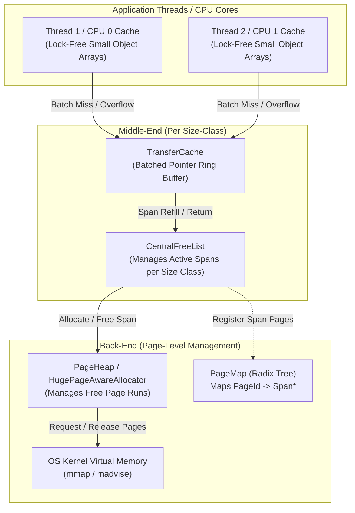

# Memory Allocator Architecture and TCMalloc Implementation Curriculum
Created: 2026-10-29

# Curriculum Context and Knowledge Connections

## Existing Knowledge Foundation
- Virtual Memory Topography: You have already established how process segments (`.text`, `.data`, `.bss`, Heap, `mmap`, Stack) are organized and protected via MMU page tables and guard pages in [07_process_memory_layout.md](file:///Users/bradleyyeo/Documents/learn/csapp3e-brad/exercises/07_process_memory_layout.md).
- Demand Paging and Anonymous Mappings: You have used `mmap` and `munmap` for zero-copy virtual memory management in [06_mmap_search.md](file:///Users/bradleyyeo/Documents/learn/csapp3e-brad/exercises/06_mmap_search.md) and explored legacy `sbrk` program break movement in [16_filesystem_inode_ops.md](file:///Users/bradleyyeo/Documents/learn/csapp3e-brad/exercises/16_filesystem_inode_ops.md).
- Power-of-Two Alignment Algebra: You have mastered bitwise alignment masking `(addr + (a - 1)) & ~(a - 1)`, `uintptr_t` casting, and overflow-safe bounds checking in [11_bump_allocator.md](file:///Users/bradleyyeo/Documents/learn/csapp3e-brad/exercises/11_bump_allocator.md).
- Dynamic Ownership Invariants: You have practiced safe `realloc` patterns and defining dangling pointers out of existence in [09_dynamic_memory_lifecycle.md](file:///Users/bradleyyeo/Documents/learn/csapp3e-brad/exercises/09_dynamic_memory_lifecycle.md).

## Bridging the Gap to General-Purpose Allocators and TCMalloc
- Individual Lifetime Deallocation: A bump allocator ([03_bump_allocator.md](file:///Users/bradleyyeo/Documents/learn/csapp3e-brad/exercises/03_bump_allocator.md)) achieves $O(1)$ allocation by forbidding individual `free(ptr)` calls. General-purpose `malloc` must reclaim arbitrary blocks in any order while minimizing both latency and memory waste.
- In-Band vs Out-of-Band Metadata: Traditional allocators (CS:APP Malloc Lab, `dlmalloc`, `glibc ptmalloc`) store block size and allocation status immediately adjacent to user payloads (boundary tags). Google's [TCMalloc](https://github.com/google/tcmalloc) decouples metadata from small allocations entirely, using virtual page math and a radix tree (`PageMap`) to map pointers to `Span` descriptors.
- Scaling Across CPU Cores: A single global heap lock serializes multi-threaded programs. TCMalloc introduces a three-tier hierarchy—Front-End (Per-CPU / Per-Thread caches), Middle-End (`TransferCache` and `CentralFreeList`), and Back-End (`PageHeap` and `Span` management)—so that common-case allocations execute with zero locks.

---

# Software Design Principles for Memory Allocators

## John Ousterhout: Deep Modules and Defining Errors Out of Existence
- Deep Interface Boundary: The standard allocator interface (`malloc`, `free`, `calloc`, `realloc`) is one of the deepest modules in systems programming. Behind four function signatures lie virtual memory paging, fragmentation control, coalescing state machines, radix trees, and lock-free caches.
- Defining Errors Out of Existence:
  - `free(nullptr)` is defined as a safe no-op rather than an error condition.
  - Alignment rounding automatically promotes arbitrary byte requests (e.g., 13 bytes) to the nearest alignment multiple or size class (e.g., 16 bytes), ensuring callers never deal with unaligned hardware faults (`SIGBUS`).
  - Splitting a free block that leaves a remainder smaller than the minimum block size defines "micro-fragmentation" out of existence by absorbing the remainder as internal padding.

## Daniel Jackson: Concept Decomposition
- Concept: `ArenaBacking` (OS Page Provider): Requests and releases page-aligned virtual memory regions from the kernel via `mmap` and `munmap`.
- Concept: `BlockCoalescer` (Boundary Tag Manager): Tracks contiguous variable-sized blocks and merges adjacent free blocks to prevent external fragmentation.
- Concept: `SizeClassMapper`: Maps arbitrary byte sizes to a discrete, finite set of canonical bucket sizes (`8, 16, 24, 32, ...`) to bound internal fragmentation while eliminating variable-size search overhead.
- Concept: `Span` and `PageMap`: Groups contiguous virtual pages into runs (`Span`) and resolves any arbitrary user pointer `ptr` to its owning `Span` in $O(1)$ time via page-number indexing (`(uintptr_t)ptr >> PAGE_SHIFT`).
- Concept: `ThreadCache` / `TransferCache`: Buffers small object pointers locally per thread or CPU core, amortizing synchronization across batches of allocations.

## Jimmy Koppel: Representation Independence and Single Authority
- Bit-Stealing Invariant: Because block sizes and span alignments are forced to multiples of 16 bytes (`alignof(max_align_t)`), the lowest 4 bits (`0b1111`) of any block size field are algebraically guaranteed to be zero. These bits serve as the single authority for allocation state (`ALLOCATED = 0x1`, `PREV_ALLOCATED = 0x2`) without increasing header size.
- Payload Overlay (Embedded Free Lists): A block is never simultaneously allocated to the user and residing on a free list. Therefore, `next` and `prev` free-list pointers are overlaid directly inside the unused payload bytes of free blocks, achieving zero extra memory overhead for free-list pointers.
- Single Authority for Span Ownership: In TCMalloc, a `Span` is owned exclusively by the `PageHeap` when unallocated, or by a specific `CentralFreeList` size class when carved into objects. The `PageMap` is the single authority mapping page IDs (`PageId`) to `Span*`.

---

# Core Fundamentals of Dynamic Memory Allocation

## The Fundamental Tension: Throughput vs Memory Utilization
- Throughput: Number of `malloc` and `free` operations completed per second. Maximized by avoiding locks, avoiding system calls, and keeping metadata lookups $O(1)$.
- Peak Memory Utilization: Ratio of aggregate live payload bytes requested by the application to the total virtual/physical heap footprint acquired from the OS. Maximized by minimizing fragmentation and metadata overhead.

## Internal vs External Fragmentation
- Internal Fragmentation: Wasted bytes *inside* an allocated block (e.g., rounding a 19-byte request up to a 32-byte size class, or attaching a 16-byte header/footer to an 8-byte payload). Quantifiable deterministically from current live requests.
- External Fragmentation: Wasted bytes *between* allocated blocks when enough aggregate free memory exists across the heap to satisfy a request, but no single contiguous free block is large enough. Caused by interleaved allocation and deallocation lifetimes.

## OS Virtual Memory Backing: Portable Anonymous mmap vs sbrk
- Why `mmap` Over `sbrk`:
  - `sbrk` moves a single linear program break (deprecated on macOS and inflexible in multi-threaded processes because memory trapped below the highest live allocation can never be returned to the OS).
  - `mmap(nullptr, length, PROT_READ | PROT_WRITE, MAP_PRIVATE | MAP_ANONYMOUS, -1, 0)` allocates independent, page-aligned virtual memory slabs anywhere in the 64-bit address space and allows returning individual slabs via `munmap`.
- Returning Physical Pages to the OS:
  - In production allocators like TCMalloc, virtual addresses remain mapped while physical RAM frames are surrendered to the OS kernel via `madvise(addr, len, MADV_FREE)` (macOS/BSD/Linux) or `madvise(addr, len, MADV_DONTNEED)` (Linux), resetting page table entries without fragmenting the virtual address space.

## Alignment, Bit-Stealing, and Boundary Tags
- 16-Byte ABI Requirement: On 64-bit x86-64 and ARM64 systems, `alignof(max_align_t)` is 16 bytes (required by SSE/NEON 128-bit vector instructions). Every pointer returned by `malloc` must satisfy `((uintptr_t)ptr & 0xF) == 0`.
- Boundary Tag Mechanics (Knuth's Method):
  - Header (`size_t`): Placed 8 bytes immediately before the user payload pointer. Stores `block_size | flags`.
  - Footer (`size_t`): Placed in the final 8 bytes of the block. Stores an identical copy of `block_size | flags`.
  - Constant-Time Coalescing: When `free(ptr)` is called, the allocator inspects the next block's header at `(uint8_t *)header + block_size` and the previous block's footer at `(uint8_t *)header - sizeof(size_t)` to merge adjacent free blocks in $O(1)$ time.
- Footer Optimization (TCMalloc / Production Coalescers):
  - Storing a footer on *allocated* blocks wastes 8 bytes per live allocation.
  - By storing a `PREV_ALLOCATED` bit (`0x2`) in the current block's header, an allocated block needs no footer; only *free* blocks write a footer at their tail to support backward coalescing.

```
Boundary Tag Block Layout (16-Byte Aligned):

Allocated Block (With Footer Optimization):
+-----------------------------------+-----------------------------------+
| Header: size | PREV_ALLOC | 0x1   | User Payload ...                  |
| (8 bytes)                         | (Aligned to 16-byte boundary)     |
+-----------------------------------+-----------------------------------+
^                                   ^
block_ptr                           user_ptr (returned by malloc)

Free Block (Minimum 32 Bytes on 64-bit):
+-------------------+-------------------+-------------------+-------------------+
| Header: size | 0  | FreeNode *prev    | FreeNode *next    | Footer: size | 0  |
| (8 bytes)         | (8 bytes)         | (8 bytes)         | (8 bytes)         |
+-------------------+-------------------+-------------------+-------------------+
^                   ^                                                           ^
block_ptr           user_ptr (overlaid with intrusive pointers)                 end of block
```

---

# Architectural Deep Dive: How Google TCMalloc Works

## Three-Tier Architecture Overview
- TCMalloc (Thread-Caching Malloc) eliminates both global lock contention and per-object boundary-tag overhead for small allocations ($\le 256\text{ KiB}$) by splitting allocation across three tiers:



## Tier 1: Front-End (ThreadCache and Per-CPU Mode)
- Size Classes: Instead of allocating arbitrary byte counts, TCMalloc maps small requests ($\le 256\text{ KiB}$) into roughly 86 discrete size classes (e.g., `8, 16, 24, 32, 48, 64, ...` bytes).
- Fast Path (`malloc`):
  - Compute size class index $c$ from requested `size`.
  - Index into the current thread's or CPU's local free list array `cache->freelist[c]`.
  - If non-empty, pop the head pointer and return immediately. Zero locks, zero system calls, ~5–10 instructions.
- Per-Thread vs Per-CPU Caching:
  - Classic TCMalloc gave every thread its own `ThreadCache` via Thread-Local Storage (`thread_local` / `__thread`). In servers with 10,000+ threads, idle threads hoarded megabytes of stranded cache memory.
  - Modern TCMalloc uses **Per-CPU caches** backed by a single virtual memory slab per logical CPU core and Linux Restartable Sequences (`rseq(2)`), bounding total front-end cache footprint by hardware core count rather than thread count.

## Tier 2: Middle-End (TransferCache and CentralFreeList)
- Why Batching Matters: When a front-end cache list for size class $c$ is empty (underflow) or exceeds its capacity watermark (overflow), moving a single object across a lock boundary would reintroduce lock contention. Instead, the front-end moves a **batch** of objects (e.g., 32 pointers at once).
- `TransferCache`: A per-size-class mutex-protected ring buffer of object batches. If Thread 1 frees 32 objects of size 64B and Thread 2 allocates 32 objects of size 64B, `TransferCache` hands the batch directly from Thread 1 to Thread 2 without touching underlying `Span` metadata.
- `CentralFreeList`: Below the `TransferCache`, each size class owns a `CentralFreeList` that maintains doubly-linked lists of `Span` structures (`nonempty_` spans that still have free objects, and `empty_` spans whose objects are all in use).

## Tier 3: Back-End (Spans, PageMap, and PageHeap)
- TCMalloc Pages vs OS Pages: TCMalloc defines its own logical page unit (typically $8\text{ KiB}$, `PAGE_SHIFT = 13`). Every virtual address `p` belongs to a deterministic `PageId`:
  $$\text{PageId} = \frac{\text{uintptr\_t}(p)}{8192} = \text{uintptr\_t}(p) \gg 13$$
- `Span`: A descriptor representing a contiguous run of $k$ TCMalloc pages (`start_page`, `num_pages`).
  - For small objects, a `Span` is homogeneous: the `CentralFreeList` slices the entire `Span` into an array of fixed-size objects of size class $c$, tracks `allocated_count`, and maintains an internal free list.
  - When `allocated_count` drops to 0, the entire `Span` is unregistered from the `CentralFreeList` and returned to the `PageHeap` to be coalesced with neighboring page spans!
- `PageMap` (Radix Tree):
  - How does `free(ptr)` know the size of `ptr` if there is no 8-byte header before `ptr`?
  - TCMalloc computes `page_id = (uintptr_t)ptr >> PAGE_SHIFT` and queries the `PageMap` radix tree: `Span *span = pagemap_get(page_id)`.
  - The `Span` records `span->size_class`. Thus, **zero bytes of header metadata** are stored inside small objects—an 8-byte allocation takes 8 bytes of RAM, not 16 or 24!
- Hugepage-Aware Allocator (**Temeraire**):
  - Modern CPUs cache virtual-to-physical translations in the Translation Lookaside Buffer (TLB). Standard $4\text{ KiB}$ pages cause severe TLB misses on gigabyte heaps; $2\text{ MiB}$ hugepages reduce TLB entries by $512\times$.
  - Temeraire packs small-page `Span` allocations into $2\text{ MiB}$ hugepage regions (`HugePageFiller`), tracking fullness and donating only completely empty $2\text{ MiB}$ hugepages back to the OS to preserve hugepage contiguity.

---

# Progressive Exercise Curriculum: Building a TCMalloc-Inspired Allocator in C23

Each exercise builds toward a complete, modular allocator in C23 (`clang -std=c23 -Wall -Wextra -Werror -pedantic -g`). Complete them in sequence inside a dedicated directory (e.g., `projects/malloc_clone/`).

## Stage 1: Implicit Free List & Boundary Tag Coalescer (CS:APP Baseline)
- Learning Objective: Master virtual memory slab acquisition via `mmap`, 16-byte payload alignment, bit-stealing headers, block splitting, and immediate 4-case boundary-tag coalescing.
- Architectural Concepts:
  - Prologue and Epilogue Sentinel Blocks: Eliminate edge-case boundary checks during coalescing by placing an allocated 16-byte Prologue block at the start of the heap slab and a 0-byte allocated Epilogue header at the end.
  - 4-Case Coalescing State Machine:
    - Case 1: Both previous and next blocks are allocated (no merge).
    - Case 2: Previous is allocated, next is free (merge current + next).
    - Case 3: Previous is free, next is allocated (merge prev + current).
    - Case 4: Both previous and next are free (merge prev + current + next).
- ASCII Memory Layout:
```
Heap Slab (Acquired via mmap, Page-Aligned):
+-------------+---------------+-------------------------------+---------------+-------------+
| Alignment   | Prologue Hdr  | Prologue Ftr  | Regular Blocks...             | Epilogue Hdr|
| Pad (8 B)   | 16 | 0x1 (8B) | 16 | 0x1 (8B) | [Hdr][Payload/Pad][Ftr]       | 0 | 0x1 (8B)|
+-------------+---------------+-------------------------------+---------------+-------------+
              ^                               ^
              heap_listp                      First allocatable user_ptr (16-byte aligned!)
```
- Bitwise Invariants & Specifications:
  - `constexpr size_t ALIGNMENT = 16;`
  - `constexpr size_t ALLOC_MASK = 0x1;`
  - `constexpr size_t PREV_ALLOC_MASK = 0x2;`
  - `constexpr size_t SIZE_MASK = ~(ALIGNMENT - 1);`
  - Every returned pointer `p` satisfies `((uintptr_t)p & (ALIGNMENT - 1)) == 0`.
  - Minimum block size `MIN_BLOCK_SIZE = 32` bytes (8B header + 16B minimum payload + 8B footer).
- C23 Interface Signatures to Implement:
```c
[[nodiscard]] bool mm_init(size_t arena_size);
void mm_teardown(void);
[[nodiscard]] void *mm_malloc(size_t size);
void mm_free(void *ptr);
[[nodiscard]] bool mm_checkheap(void);
```
- Verification Harness & Test Scenarios:
  - Alignment check: Allocate sizes `1, 7, 13, 16, 25, 64` and assert `((uintptr_t)ptr % 16) == 0`.
  - Coalescing check: Allocate 3 contiguous blocks `A`, `B`, `C` of 64 bytes each. Free `A`, then `C`, then `B` (testing Case 4 triple merge). Request a single block of 160 bytes and assert it receives the exact starting address of `A`.
  - Heap consistency checker (`mm_checkheap`): Assert that walking from Prologue to Epilogue reaches the exact Epilogue address, no two consecutive blocks are both marked free, and every free block's header equals its footer.

## Stage 2: Intrusive Explicit Doubly-Linked Free List & Footer Elision
- Learning Objective: Reduce allocation search time from $O(N_{\text{total blocks}})$ to $O(N_{\text{free blocks}})$ using overlaid intrusive pointers, and eliminate the 8-byte footer from allocated blocks using the `PREV_ALLOC` bit.
- Architectural Concepts:
  - Overlaid Intrusive Pointers: Cast the payload area of any free block to a `FreeNode` struct containing `prev` and `next` pointers.
  - LIFO Insertion and Coalesce Unlinking: Inserting freed blocks at the head of the free list takes $O(1)$. When coalescing with an adjacent free block, splice that neighbor out of the doubly-linked list in $O(1)$ before merging sizes.
  - Footer Elision: Allocated blocks store only an 8-byte header; their payload extends all the way to the end of the block. The subsequent block's header stores `PREV_ALLOC_MASK (0x2)`. During `mm_free(ptr)`, check `(header & PREV_ALLOC_MASK)` before attempting to read a previous footer.
- ASCII Memory Layout:
```
Allocated Block (Min 32 Bytes: 8B Header + up to 24B User Payload, ZERO Footer!):
+-----------------------------------+---------------------------------------------------+
| Header: size | PREV_ALLOC | 0x1   | User Payload (up to size - 8 bytes)               |
+-----------------------------------+---------------------------------------------------+

Free Block (Min 32 Bytes: 8B Header + 8B prev + 8B next + 8B Footer):
+-------------------+-------------------+-------------------+-------------------+
| Header: size |PA|0| FreeNode *prev    | FreeNode *next    | Footer: size |PA|0|
+-------------------+-------------------+-------------------+-------------------+
```
- C23 Interface Signatures to Implement:
```c
typedef struct FreeNode {
  struct FreeNode *prev;
  struct FreeNode *next;
} FreeNode;

void freelist_insert_head(FreeNode **head, FreeNode *node);
void freelist_remove(FreeNode **head, FreeNode *node);
[[nodiscard]] void *mm_realloc(void *ptr, size_t new_size);
```
- Verification Harness & Test Scenarios:
  - Payload density verification: Allocate consecutive 24-byte blocks (`mm_malloc(24)`). Verify that adjacent returned pointers are separated by exactly 32 bytes (`(uintptr_t)p2 - (uintptr_t)p1 == 32`), proving that allocated blocks have only an 8-byte header and zero footer overhead (whereas Stage 1 with footers required 48 bytes).
  - Pattern corruption test: Fill every allocated payload with `0xAA` via `memset`, free half in pseudo-random order (overwriting with `prev`/`next` pointers), reallocate, and verify remaining live blocks still contain intact `0xAA` bytes.
  - In-place `mm_realloc`: Verify that expanding a block whose next neighbor is free absorbs the neighbor in-place without calling `memcpy` when the combined size is sufficient.

## Stage 3: TCMalloc Back-End — PageHeap, Spans, and Radix-Tree PageMap
- Learning Objective: Replace in-band boundary tags with TCMalloc's out-of-band `Span` and `PageMap` architecture, enabling zero-header small allocations and $O(1)$ pointer-to-Span resolution.
- Architectural Concepts:
  - Logical Pages (`PAGE_SIZE = 8192`, `PAGE_SHIFT = 13`): Divide virtual memory into $8\text{ KiB}$ pages. Any address `ptr` maps to `PageId = (uintptr_t)ptr >> 13`.
  - `Span` Metadata Struct: Tracks a contiguous run of pages (`start_page`, `num_pages`), its current state (`SPAN_IN_USE_SMALL`, `SPAN_IN_USE_LARGE`, `SPAN_ON_PAGEHEAP`), its `size_class`, an intrusive freelist of objects within the span (`void *freelist`), and `allocated_count`.
  - Two-Level Radix Tree `PageMap`:
    - 48-bit user virtual addresses shifted right by 13 yield a 35-bit `PageId`.
    - Split the 35-bit `PageId` into an 18-bit Root Index (`262,144` entries) and a 17-bit Leaf Index (`131,072` entries), allocating leaf arrays on demand via a metadata bump allocator ([11_bump_allocator.md](file:///Users/bradleyyeo/Documents/learn/csapp3e-brad/exercises/11_bump_allocator.md)).
- ASCII Memory Layout:
```
48-Bit Virtual Address to Span Lookup via 2-Level Radix Tree PageMap:
+-------------------------+-------------------------+-------------------+
| Bits 47..30 (18 bits)   | Bits 29..13 (17 bits)   | Bits 12..0 (13b)  |
| Root Index (L1)         | Leaf Index (L2)         | Offset in 8KB Page|
+-------------------------+-------------------------+-------------------+
            |                         |
            v                         v
      root[L1_idx] -----------> leaf[L2_idx] ===> Span* (Owning Descriptor)
```
- C23 Interface Signatures to Implement:
```c
constexpr size_t TCM_PAGE_SHIFT = 13;
constexpr size_t TCM_PAGE_SIZE = (1ULL << TCM_PAGE_SHIFT); // 8192 bytes

typedef uintptr_t PageId;

typedef enum {
  SPAN_FREE = 0,
  SPAN_SMALL_OBJECTS = 1,
  SPAN_LARGE_OBJECT = 2
} SpanState;

typedef struct Span {
  PageId start_page;
  size_t num_pages;
  uint32_t size_class;
  uint32_t allocated_count;
  SpanState state;
  void *freelist;
  struct Span *next;
  struct Span *prev;
} Span;

[[nodiscard]] bool pagemap_set(PageId page, Span *span);
[[nodiscard]] Span *pagemap_get(PageId page);
[[nodiscard]] Span *pageheap_allocate_span(size_t num_pages);
void pageheap_free_span(Span *span);
```
- Verification Harness & Test Scenarios:
  - Radix tree mapping: Allocate a 4-page `Span`, register all 4 `PageId`s in the `PageMap`, and assert that any arbitrary byte address within `[start_addr, start_addr + 4 * 8192)` resolves to that exact `Span*` via `pagemap_get((uintptr_t)addr >> TCM_PAGE_SHIFT)`.
  - Span coalescing in `PageHeap`: Allocate three consecutive 1-page spans `S1`, `S2`, `S3`. Free `S1`, `S3`, and `S2` back to `pageheap_free_span`. Verify via `pagemap_get` that `S1`, `S2`, and `S3` have merged into a single 3-page free `Span` and moved to the `PageHeap` 3-page bucket.

## Stage 4: TCMalloc Middle-End — Size Classes and CentralFreeList
- Learning Objective: Implement TCMalloc's segregated size-class table and `CentralFreeList`, carving 8 KiB `Span` pages into headerless fixed-size objects.
- Architectural Concepts:
  - Size Class Table: Map sizes up to `8192` bytes into compact size classes (`8, 16, 24, 32, 48, 64, 80, 96, 112, 128, 160, 192, 224, 256, 320, 384, 448, 512, ...`).
  - Zero-Header Slicing: When `CentralFreeList[c]` needs objects, it requests a 1-page `Span` from `PageHeap` and slices the raw $8192\text{ B}$ page into $\lfloor 8192 / \text{class\_size} \rfloor$ contiguous objects, threading an embedded singly-linked list (`*(void **)obj = next_obj`) through the free objects.
  - Span Reclamation: When an object `ptr` is freed to `CentralFreeList[c]`, look up its `Span` in `PageMap`, push `ptr` onto `span->freelist`, and decrement `span->allocated_count`. If `allocated_count == 0`, unlink the `Span` from `CentralFreeList[c]` and return it to `PageHeap`.
- ASCII Memory Layout:
```
8 KiB Span Carved into 16-Byte Size-Class Objects (512 Objects, ZERO Headers):
+-----------------+-----------------+-----------------+-----+-----------------+
| Obj 0 (16 B)    | Obj 1 (16 B)    | Obj 2 (16 B)    | ... | Obj 511 (16 B)  |
| [next_ptr | --] | [next_ptr | --] | [nullptr  | --] |     | [In UsePayload] |
+-----------------+-----------------+-----------------+-----+-----------------+
^
Span Base (PageId * 8192) -> Registered in PageMap -> Span { size_class = 2 (16B) }
```
- C23 Interface Signatures to Implement:
```c
[[nodiscard]] uint32_t size_to_class(size_t size);
[[nodiscard]] size_t class_to_size(uint32_t size_class);

/* Batch transfer interface between Front-End and CentralFreeList */
[[nodiscard]] size_t central_remove_range(uint32_t size_class, void **batch_out, size_t count);
void central_insert_range(uint32_t size_class, void **batch_in, size_t count);
```
- Verification Harness & Test Scenarios:
  - True zero-header density test: Request 512 objects of 16 bytes (`tcm_malloc(16)`). Verify that all 512 objects reside within the *exact same* 8,192-byte page (`((uintptr_t)p[i] >> 13) == ((uintptr_t)p[0] >> 13)`). This is impossible in any boundary-tag allocator!
  - Full-span reclamation test: Free all 512 objects. Assert that the owning `Span` is automatically returned to `PageHeap` (`span->state == SPAN_FREE`).

## Stage 5: TCMalloc Front-End — ThreadCache & Batch TransferCache
- Learning Objective: Eliminate lock contention on the fast path by implementing a lock-free C23 `thread_local` front-end cache and a mutex-guarded `TransferCache` ring buffer for multi-threaded scalability.
- Architectural Concepts:
  - Fast-Path Thread-Local Storage: Declare `static thread_local ThreadCache tls_cache;`. Each `SizeClassList` inside `ThreadCache` holds a singly-linked list of free objects (`void *head`), current `length`, and `max_length`.
  - Batch Refill and Flush:
    - On allocation miss (`head == nullptr`), fetch `batch_size` objects (e.g., 32 objects) from `TransferCache[c]` (which falls back to `CentralFreeList[c]`) in a single lock acquisition.
    - On deallocation overflow (`length > max_length`), return `batch_size` objects back to `TransferCache[c]`.
  - Cross-Thread Producer-Consumer Balance: One thread can allocate objects while a completely different worker thread calls `tcm_free(ptr)`—`tcm_free` simply pushes `ptr` into the *calling thread's* local `ThreadCache`, and batch flushing naturally recycles batches back through the shared `TransferCache`!
- C23 Interface Signatures to Implement:
```c
typedef struct {
  void *head;
  uint32_t length;
  uint32_t max_length;
} FreeListBin;

typedef struct {
  FreeListBin bins[NUM_SIZE_CLASSES];
  bool initialized;
} ThreadCache;

[[nodiscard]] void *tcm_malloc(size_t size);
void tcm_free(void *ptr);
[[nodiscard]] void *tcm_calloc(size_t count, size_t size);
[[nodiscard]] void *tcm_realloc(void *ptr, size_t new_size);
```
- Verification Harness & Test Scenarios:
  - Multi-threaded contention benchmark (`pthread_create` with 8 threads): Run 1,000,000 `malloc`/`free` pairs per thread across random small size classes (`8B` to `512B`). Compare wall-clock throughput (`clock_gettime(CLOCK_MONOTONIC, ...)`) against a global-mutex lock around Stage 2.
  - Producer-consumer cross-thread stress test: Have 4 producer threads allocate 100,000 small objects and push them into a ring buffer; have 4 consumer threads pop and call `tcm_free(ptr)`. Verify bounded memory usage and zero data corruption under ThreadSanitizer (`-fsanitize=thread`) and UndefinedBehaviorSanitizer (`-fsanitize=undefined`).

---

# Active Recall and Socratic Checkpoints

## Fundamentals and Boundary Tags
- Why must the minimum allocatable block size in a 64-bit explicit-free-list boundary-tag allocator with footers be 32 bytes, even when the user calls `malloc(1)`?
- When removing the footer from allocated blocks (Stage 2), how does `free(ptr)` know whether it is safe to inspect the 8 bytes immediately preceding `ptr`'s header?
- Why can an allocator not coalesce two free blocks that belong to two separate `mmap` system call invocations, unless it tracks virtual address adjacency?

## TCMalloc Architecture and Tradeoffs
- In Stage 1 and 2, `free(ptr)` determines the block size by reading `*((size_t *)ptr - 1)`. In TCMalloc (Stage 3 and 4), small allocations have *no header* before `ptr`. Trace the exact sequence of bitwise and array operations `tcm_free(ptr)` performs to discover the object's byte size.
- If a `Span` is carved into 16-byte objects, why can TCMalloc not coalesce two adjacent 16-byte free objects into a 32-byte object inside that `Span`? Why is that restriction actually an advantage for speed and fragmentation?
- Why does modern TCMalloc prefer Per-CPU caches (using Linux `rseq`) over Per-Thread caches (`thread_local`) in data-center binaries with 20,000 threads running on a 64-core machine?
- What is the role of the `TransferCache` between the front-end `ThreadCache` and the `CentralFreeList`? When Thread A frees a batch of 32 objects and Thread B immediately requests a batch of 32 objects of the same size class, what work does the `TransferCache` avoid?
