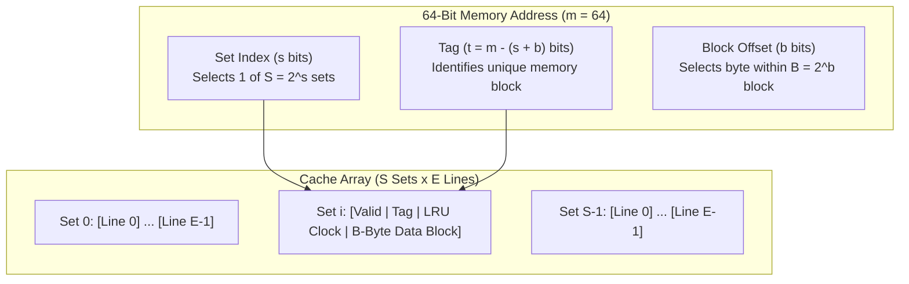
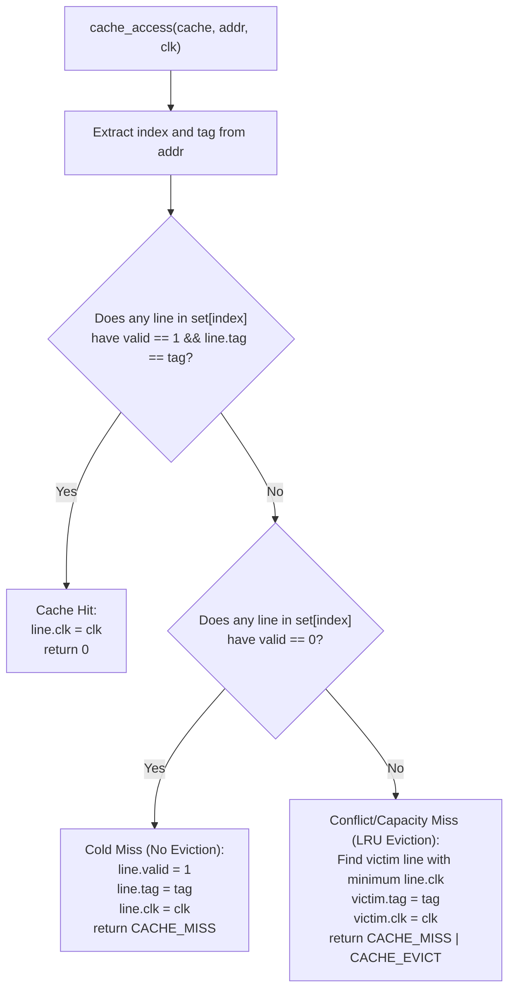
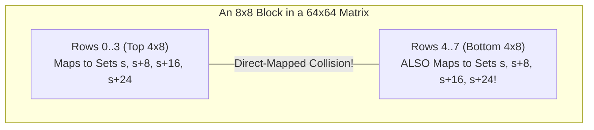

# Curriculum Context and Prerequisites

## How Cache Lab Connects to Your Existing Notes

- [06-memory-hierarchy-caching/README.md](file:///Users/bradleyyeo/Documents/learn/csapp3e-brad/csi/01-computer-architecture/06-memory-hierarchy-caching/README.md) introduced the $(S, E, B, m)$ cache tuple, temporal vs spatial locality, and why row-major Stride-1 traversal outperforms column-major Stride-$N$ traversal.
- [07-memory-hierarchy-data-layout/README.md](file:///Users/bradleyyeo/Documents/learn/csapp3e-brad/csi/01-computer-architecture/07-memory-hierarchy-data-layout/README.md) demonstrated how packing data into 64-byte cache lines maximizes spatial locality.
- [08_pointer_arithmetic_strides.md](file:///Users/bradleyyeo/Documents/learn/csapp3e-brad/exercises/08_pointer_arithmetic_strides.md) established the 2D row-major address formula:
  $$\text{Address}(\&A[i][j]) = \text{Base}(A) + (i \times M + j) \times \text{sizeof}(\text{int})$$
- [06_valgrind_fundamentals.md](file:///Users/bradleyyeo/Documents/learn/csapp3e-brad/exercises/06_valgrind_fundamentals.md) covered Valgrind Dynamic Binary Instrumentation (DBI) and symmetrical memory destruction (`init` / `destroy`).

## Knowledge Gaps Addressed by This Guide

- Bit-level address partitioning (`Tag`, `Set Index`, `Block Offset`) and why set bits occupy the middle of a physical address rather than the high-order bits.
- Designing a deterministic, leak-free LRU cache state machine in C ([csim.c](file:///Users/bradleyyeo/Documents/learn/csapp3e-brad/labs/05_cachelab/cachelab-handout/csim.c)) driven by Valgrind `lackey` memory traces.
- Diagnosing direct-mapped conflict thrashing, power-of-two row aliasing, and diagonal self-eviction in matrix transposition ([trans.c](file:///Users/bradleyyeo/Documents/learn/csapp3e-brad/labs/05_cachelab/cachelab-handout/trans.c)).
- Deriving the exact block sizes and register-staging transformations required for $32 \times 32$, $64 \times 64$, and $61 \times 67$ matrices.

---

# Hardware Cache Organization and Address Decoding

## The $(S, E, B, m)$ Geometry



### Address Bit Parameters

- $m$: Total bits in a physical/virtual memory address ($m = 64$ on x86-64).
- $s$: Number of set index bits, defining $S = 2^s$ total cache sets.
- $E$: Number of cache lines per set (associativity).
  - $E = 1$: Direct-mapped cache (every memory block maps to exactly one cache line).
  - $1 < E < C/B$: $E$-way set-associative cache.
  - $E = C/B$ ($S = 1$): Fully associative cache.
- $b$: Number of block offset bits, defining $B = 2^b$ bytes per cache line.
- $t = m - (s + b)$: Number of tag bits stored in each cache line to disambiguate which memory block currently occupies the line.
- Total data capacity $C$:
  $$C = S \times E \times B = 2^s \times E \times 2^b \text{ bytes}$$

## Why Set Index Bits Are in the Middle (Middle-Bit Indexing)

### High-Order Bit Indexing (Flawed Alternative)

- If the Set Index used the highest $s$ bits of the address, then $2^{m-s}$ consecutive bytes of memory would all map to the exact same cache set.
- An array fits in contiguous memory, so scanning an array sequentially would hammer a single cache set while the remaining $S - 1$ sets sit completely idle.

### Middle-Bit Indexing (Hardware Standard)

- Placing the Set Index in bits $[b \dots b+s-1]$ means consecutive $B$-byte blocks cycle through Set $0$, Set $1$, $\dots$, Set $S-1$ sequentially.
- A contiguous region of size $S \times B$ bytes distributes evenly across all $S$ sets without a single set collision.

## Bitwise Extraction Idioms in C

```c
uint64_t offset = addr & ((1ULL << b) - 1);
uint64_t index  = (addr >> b) & ((1ULL << s) - 1);
uint64_t tag    = addr >> (b + s);
```

### Why `1ULL` Is Mandatory

- Writing `1 << s` uses a 32-bit signed `int` literal, causing undefined behavior if $s \ge 31$ and sign-extension bugs when masking a `uint64_t`.
- Using `1ULL << s` guarantees 64-bit unsigned shift semantics across all valid bit widths.

## The Three Classes of Cache Misses (The 3 Cs)

### Cold (Compulsory) Miss

- Occurs when a cache set has at least one invalid line (`valid == 0`) and a block is referenced for the first time.
- Inevitable during initial data loading; reduced only by larger block sizes $B$ (spatial prefetching).

### Capacity Miss

- Occurs when the program's active working set (the set of unique cache blocks accessed within a loop phase) exceeds total cache size $C = S \times E \times B$.
- Mitigated by loop blocking (tiling), which shrinks the active working set so it fits inside $C$.

### Conflict Miss

- Occurs when total cache capacity $C$ is large enough to hold the active working set, but multiple active objects map to the **exact same Set Index** more than $E$ times.
- Most severe in direct-mapped caches ($E = 1$), where even two active variables mapping to the same set will evict each other on every alternating access (thrashing).

---

# Part A: Designing the Cache Simulator (`csim.c`)

## Problem Specification and Trace Semantics

### Valgrind `lackey` Memory Trace Format

- Generated via `valgrind --log-fd=1 --tool=lackey -v --trace-mem=yes`.
- Each line follows the format:
  ```
  [space]operation address,size
  ```
- Example from [traces/yi.trace](file:///Users/bradleyyeo/Documents/learn/csapp3e-brad/labs/05_cachelab/cachelab-handout/traces/yi.trace):
  ```
   L 10,1
   M 20,1
   L 22,1
   S 18,1
   L 110,1
   L 210,1
   M 12,1
  ```

### Operation Types

- `I`: Instruction load (starts at column 0 without a leading space). Must be **ignored** by `csim.c`.
- `L`: Data load (1 cache access).
- `S`: Data store (1 cache access).
- `M`: Data modify, representing a read-modify-write instruction such as `incq (%rax)` (modeled as **2 sequential cache accesses**: a Load followed immediately by a Store to the same address).

### Why `size` and Block Offset Are Ignored in `csim.c`

- `csim.c` simulates hit/miss/eviction counts, not actual byte storage values.
- The lab specification guarantees that memory accesses are properly aligned and never straddle a cache block boundary.
- Therefore, `csim.c` never needs to allocate `B` bytes of data storage per line; storing `valid`, `tag`, and `clk` (LRU timestamp) is sufficient.

## Software Design Principles Applied to `csim.c`

### Concept Separation (Daniel Jackson)

- Separate CLI argument parsing (`args_t`), cache hardware state (`cache_t`, `set_t`, `line_t`), and trace stream parsing (`main`).
- See [csim.c](file:///Users/bradleyyeo/Documents/learn/csapp3e-brad/labs/05_cachelab/cachelab-handout/csim.c#L70-L83) for the three-tier struct hierarchy (`cache_t` $\to$ `set_t` $\to$ `line_t`).

### Single Authority State Machine (Jimmy Koppel)

- A single function [`cache_access`](file:///Users/bradleyyeo/Documents/learn/csapp3e-brad/labs/05_cachelab/cachelab-handout/csim.c#L120-L156) owns all mutations to cache lines and returns a bitmask (`0` for hit, `CACHE_MISS`, or `CACHE_MISS | CACHE_EVICT`).
- Both `L` and `S` execute identical cache tag lookup and replacement logic; `M` simply invokes `cache_access` twice in a 2-iteration loop rather than duplicating load/store code paths.

### Symmetrical Lifecycle Management

- [`cache_init`](file:///Users/bradleyyeo/Documents/learn/csapp3e-brad/labs/05_cachelab/cachelab-handout/csim.c#L85-L108) allocates the outer array of $S = 1 \ll s$ sets and each set's inner array of $E$ lines, initializing `valid = 0`.
- [`cache_destroy`](file:///Users/bradleyyeo/Documents/learn/csapp3e-brad/labs/05_cachelab/cachelab-handout/csim.c#L110-L115) frees every set's `lines` array in a loop before freeing `cache->sets`, ensuring zero Valgrind leaks.

## Cache Access State Machine and LRU Replacement



### Logical Timestamp LRU vs Doubly-Linked List LRU

- Because $E$ in hardware caches is small (typically $1 \le E \le 16$), an $O(E)$ linear scan over a contiguous `line_t` array is faster and simpler than maintaining doubly-linked list pointers.
- Monotonic counter `clk` increments on every access (`clk++`).
- Updating `line->clk = clk` on both hits and misses records the exact logical time of most recent use.
- On eviction, the line in `set->lines[0 .. E-1]` with the smallest `clk` value is the Least Recently Used victim.

## Hand-Tracing `traces/yi.trace` ($s=4, E=1, b=4$)

### Configuration Parameters

- $s = 4 \implies S = 16$ sets (hex index `0x0` to `0xF`).
- $E = 1 \implies$ Direct-mapped (1 line per set).
- $b = 4 \implies B = 16$ bytes per block (low 4 bits = 1 hex digit is the block offset).
- For any hex address `0x...TSO`, the rightmost hex digit `O` is the block offset ($b=4$), the second hex digit from the right `S` is the set index ($s=4$), and all upper hex digits `T` form the tag!

### Step-by-Step Trace Execution

| Trace Line | Address (Hex) | Tag (`addr >> 8`) | Set Index (`(addr >> 4) & 0xF`) | Offset (`addr & 0xF`) | Action & Outcome |
| :--- | :--- | :--- | :--- | :--- | :--- |
| `L 10,1` | `0x010` | `0x0` | `0x1` | `0x0` | Set 1 is invalid $\to$ **miss** (loads Tag `0x0` into Set 1) |
| `M 20,1` | `0x020` | `0x0` | `0x2` | `0x0` | Load: Set 2 is invalid $\to$ **miss** (loads Tag `0x0` into Set 2); Store: Set 2 has Tag `0x0` $\to$ **hit** |
| `L 22,1` | `0x022` | `0x0` | `0x2` | `0x2` | Set 2 has Tag `0x0` (same 16B cache line!) $\to$ **hit** |
| `S 18,1` | `0x018` | `0x0` | `0x1` | `0x8` | Set 1 has Tag `0x0` (same 16B cache line!) $\to$ **hit** |
| `L 110,1` | `0x110` | `0x1` | `0x1` | `0x0` | Set 1 is valid with Tag `0x0` $\neq$ `0x1` $\to$ **miss + eviction** (replaces Set 1 with Tag `0x1`) |
| `L 210,1` | `0x210` | `0x2` | `0x1` | `0x0` | Set 1 is valid with Tag `0x1` $\neq$ `0x2` $\to$ **miss + eviction** (replaces Set 1 with Tag `0x2`) |
| `M 12,1` | `0x012` | `0x0` | `0x1` | `0x2` | Load: Set 1 has Tag `0x2` $\neq$ `0x0` $\to$ **miss + eviction** (replaces Set 1 with Tag `0x0`); Store: Set 1 now has Tag `0x0` $\to$ **hit** |

- Final Totals: `hits:4 misses:5 evictions:3`.
- Verify on command line: `./csim-ref -v -s 4 -E 1 -b 4 -t traces/yi.trace`.

---

# Part B: Matrix Transpose and Cache Conflict Mechanics (`trans.c`)

## Hardware Target and Evaluation Constraints

### Target Cache Geometry ($s=5, E=1, b=5$)

- $s = 5 \implies S = 2^5 = 32$ cache sets (Sets `0` through `31`).
- $E = 1 \implies$ Direct-mapped cache (zero tolerance for set collisions: 2 active lines in the same set immediately thrash).
- $b = 5 \implies B = 2^5 = 32$ bytes per cache line.
- Since `sizeof(int) == 4`, each 32-byte cache line holds exactly **8 consecutive integers**.
- Total cache capacity:
  $$C = 32 \text{ sets} \times 1 \text{ line/set} \times 32 \text{ bytes/line} = 1024 \text{ bytes} = 256 \text{ integers}$$

### Programming Rules and Stack Filtering

- At most **12 local `int` variables** per transpose function.
- No recursion, no bit-packing arrays into scalars, no `malloc` or auxiliary arrays, and no modifying matrix `A`.
- How [test-trans.c](file:///Users/bradleyyeo/Documents/learn/csapp3e-brad/labs/05_cachelab/cachelab-handout/test-trans.c#L123-L125) ignores your 12 local variables:
  - In x86-64 Linux, the user stack resides near the top of the 48-bit virtual address space (`0x7ff...`), whereas static global arrays `A` and `B` in [tracegen.c](file:///Users/bradleyyeo/Documents/learn/csapp3e-brad/labs/05_cachelab/cachelab-handout/tracegen.c#L28-L29) reside in the `.bss` segment below `0xffffffff`.
  - `test-trans.c` filters out any memory reference with `addr >= 0xffffffff`. Thus, local scalar variables (whether kept in CPU registers or spilled to the stack) generate **zero counted cache misses**!

## Why Naive Transpose Fails: Stride-N and Conflict Thrashing

### Access Pattern of `B[j][i] = A[i][j]`

- As inner loop `j` increments by 1:
  - `A[i][j]` steps by $+4$ bytes (Stride-1 across row `i`): 1 miss per 8 integers ($12.5\%$ miss rate).
  - `B[j][i]` steps by $+4M$ bytes (Stride-$M$ down column `i`): every single write touches a different cache line!
- Worse, if a column of `B` spans more than 32 cache sets (or aliases with itself every $1024$ bytes), lines of `B` are evicted before the next row `i + 1` can reuse them!

## The Three Fundamental Aliasing Mechanisms

### Mechanism 1: The 1024-Byte Wrap-Around Period

- Because $S \times B = 32 \times 32 = 1024$ bytes ($256$ `int`s), the Set Index of any address `addr` is determined modulo $1024$:
  $$\text{SetIndex}(\text{addr}) = \left\lfloor \frac{\text{addr} \bmod 1024}{32} \right\rfloor$$
- Any two addresses separated by an exact multiple of $1024$ bytes ($256$ `int`s) map to the **exact same cache set**!

### Mechanism 2: Mutual Alignment of Matrices `A` and `B`

- Look at [tracegen.c](file:///Users/bradleyyeo/Documents/learn/csapp3e-brad/labs/05_cachelab/cachelab-handout/tracegen.c#L28-L29):
  ```c
  static int A[256][256];
  static int B[256][256];
  ```
- Wait: `tracegen.c` declares `A` and `B` as $256 \times 256$ arrays ($256 \times 256 \times 4 = 262,144 = 256 \times 1024$ bytes), and passes `A` and `B` cast as `int A[N][M]` and `int B[M][N]` to `transpose_submit`!
- Because $\text{Base}(B) - \text{Base}(A) = 262,144$ bytes is an exact multiple of $1024$ bytes:
  $$\text{SetIndex}(\&A[i][j]) == \text{SetIndex}(\&B[i][j]) \quad \text{for all } (i, j)$$
- Every element $A[i][j]$ maps to the **exact same cache set** as the corresponding element $B[i][j]$!

### Mechanism 3: Diagonal Self-Eviction ($bi == bj$)

- When transposing an off-diagonal block ($bi \neq bj$), the rows of $A[bi \dots][bj \dots]$ and the rows of $B[bj \dots][bi \dots]$ map to disjoint sets in the cache.
- When transposing a **diagonal block** ($bi == bj$), row $k$ of the block in $A$ (`A[k][bi..bi+7]`) and row $k$ of the block in $B$ (`B[k][bi..bi+7]`) map to the **exact same cache set**!
- In a direct-mapped cache ($E = 1$), if you execute `B[j][i] = A[i][j]` when $i == j$:
  - Reading `A[i][i]` loads $A$'s cache line into Set $s$.
  - Writing `B[i][i]` immediately evicts $A$'s cache line from Set $s$ to load $B$'s cache line!
  - On the very next iteration `j = i + 1`, reading `A[i][i+1]` misses again because $A$'s line was just evicted by `B[i][i]`!

---

# Case-by-Case Transpose Optimization Strategies

## Case 1: The $32 \times 32$ Matrix (Target: $< 300$ Misses)

### Cache Set Mapping of a $32 \times 32$ Matrix

- Row width: $M = 32$ integers $= 128$ bytes $= 4$ cache lines (4 sets per row).
- Since there are 32 sets in total, the entire cache holds exactly:
  $$\frac{32 \text{ sets}}{4 \text{ sets/row}} = 8 \text{ full rows}$$
- Row $i$ and Row $i + 8$ map to the **exact same 4 cache sets**:

| Matrix Row | Cache Sets Occupied |
| :--- | :--- |
| Row 0 (`A[0][0..31]`) | Sets `0, 1, 2, 3` |
| Row 1 (`A[1][0..31]`) | Sets `4, 5, 6, 7` |
| $\dots$ | $\dots$ |
| Row 7 (`A[7][0..31]`) | Sets `28, 29, 30, 31` |
| Row 8 (`A[8][0..31]`) | Sets `0, 1, 2, 3` (Collides with Row 0!) |

### Why $8 \times 8$ Blocking + 8 Scalar Registers Solves $32 \times 32$

- Partitioning into $8 \times 8$ blocks ensures that:
  - Width $8 \text{ ints} = 32$ bytes matches 1 full cache line.
  - Height $8 \text{ rows}$ spans 8 distinct cache sets without self-collision inside the block!
- To eliminate diagonal self-eviction when $bi == bj$, read all 8 elements of `A[i][bj .. bj+7]` into 8 local scalar variables (`t0` through `t7`) in a single burst before writing `B[bj .. bj+7][i]`:
  - Loading `t0 .. t7` touches `A[i][bj..bj+7]` once (1 cold miss, 7 hits) and never touches row `i` of `A` again!
  - Writing `B[bj .. bj+7][i]` then loads the 8 rows of `B` into cache without ever needing `A[i]` to remain resident.
- Miss calculation:
  - Ideal minimum for $32 \times 32$: $\frac{32 \times 32}{8} \times 2 = 256$ misses.
  - Achieved in [trans.c](file:///Users/bradleyyeo/Documents/learn/csapp3e-brad/labs/05_cachelab/cachelab-handout/trans.c#L25-L48): **287 misses** (full 8/8 points).

---

## Case 2: The $64 \times 64$ Matrix (Target: $< 1300$ Misses)

### Why $64 \times 64$ Is Adversarially Hard

- Row width: $M = 64$ integers $= 256$ bytes $= 8$ cache lines (8 sets per row).
- Since there are 32 sets in total, the entire $1\text{ KB}$ cache holds only:
  $$\frac{32 \text{ sets}}{8 \text{ sets/row}} = 4 \text{ full rows!}$$
- **Every 4 rows alias to the exact same cache sets** (`Row 0` and `Row 4` collide in Sets `0..7`!).



### The Dilemma Between $8 \times 8$ and $4 \times 4$ Blocking

- If you use standard $8 \times 8$ blocking: writing `B[bj .. bj+7][i]` touches 8 consecutive rows of `B`, so writing `B[bj+4 .. bj+7][i]` immediately evicts `B[bj+0 .. bj+3][i]` on every single iteration! Misses skyrocket to $> 4000$.
- If you shrink to $4 \times 4$ blocking: no intra-block row collisions occur, **but** each 32-byte cache line holds 8 integers, and a $4 \times 4$ block only uses 4 of them before the line is evicted later. Half of every cache line is wasted, yielding $\sim 1700$ misses (failing the $< 1300$ threshold).

### The Solution: $8 \times 8$ Outer Blocks with $4 \times 4$ Quadrant Staging in `B`

- Divide each $8 \times 8$ block of `A` and `B` into four $4 \times 4$ quadrants:
  $$A = \begin{bmatrix} A_{11} & A_{12} \\ A_{21} & A_{22} \end{bmatrix}, \quad B = \begin{bmatrix} B_{11} & B_{12} \\ B_{21} & B_{22} \end{bmatrix}$$
- Goal: Compute $B_{11} = A_{11}^T$, $B_{12} = A_{21}^T$, $B_{21} = A_{12}^T$, and $B_{22} = A_{22}^T$ while **never touching both the top 4 rows (`B11, B12`) and bottom 4 rows (`B21, B22`) of `B` in the same inner loop** unless transitioning!

### Phase 1 and 2: Top Half of `A` into Top Half of `B`

- Iterate `i` over the top 4 rows of the block (`bi` to `bi + 3`).
- Read all 8 ints of row `i` of `A` (`A11` and `A12`) into `t0 .. t7`, utilizing the full 8-int cache line of `A`.
- Write `t0 .. t3` ($A_{11}^T$) into its final home in $B_{11}$ (`B[bj+0..3][i]`).
- Instead of writing `t4 .. t7` ($A_{12}^T$) into $B_{21}$ (which would touch rows `bj+4..7` of `B` and evict $B_{11}$), park `t4 .. t7` in the upper-right quadrant $B_{12}$ (`B[bj+0..3][i+4]`), which resides in the exact same 4 cache lines already loaded for $B_{11}$.

### Phase 3 and 4: Register Handoff ($B_{12} \leftrightarrow A_{21}^T$) and Bottom Half of `B`

- Iterate `j` from `bj` to `bj + 3`, stepping through the 4 rows of the top half of `B` one final time:
  - Load column `j` of $A_{21}$ (`A[bi+4..7][j]`) into `t0 .. t3`.
  - Rescue the parked row `j` of $B_{12}$ (`B[j][bi+4..7]`) into `t4 .. t7` (100% cache hit because `B`'s top 4 rows remain in cache).
  - Overwrite $B_{12}$ (`B[j][bi+4..7]`) with `t0 .. t3` ($A_{21}^T$ is now in its final position, and row `j` of `B` is never needed again).
  - Load column `j + 4` of $A_{22}$ (`A[bi+4..7][j+4]`) into `t0 .. t3`.
  - Write the rescued `t4 .. t7` into row `j + 4` of $B_{21}$ (`B[j+4][bi+0..3]`) and `t0 .. t3` into row `j + 4` of $B_{22}$ (`B[j+4][bi+4..7]`). Because row `j` is completely finished, evicting Set `j` to load Set `j + 4` causes zero future conflict misses.
- Achieved in [trans.c](file:///Users/bradleyyeo/Documents/learn/csapp3e-brad/labs/05_cachelab/cachelab-handout/trans.c#L49-L98): 1139 misses (full 8/8 points, well below 1300).

---

## Case 3: The $61 \times 67$ Irregular Matrix (Target: $< 2000$ Misses)

### Why Prime Dimensions Eliminate Conflict Thrashing

- Here $N = 67$ rows, $M = 61$ columns.
- Row stride: $61 \text{ ints} \times 4 \text{ bytes} = 244$ bytes per row.
- Because $\gcd(244, 1024) = 4 \neq 256$, consecutive rows do **not** align on power-of-two set boundaries!
- Moving down a column advances the Set Index by $\lfloor 244 / 32 \rfloor = 7.625$ sets per row, naturally spreading column elements across all 32 cache sets without pathological 4-row or 8-row aliasing.

### Strategy: $16 \times 16$ Tile Blocking with Boundary Guards

- Because conflict thrashing is absent, we simply maximize spatial locality with a $16 \times 16$ tile size and guard against out-of-bounds indices (`i < N` and `j < M`):
  ```c
  for (int bi = 0; bi < N; bi += 16) {
      for (int bj = 0; bj < M; bj += 16) {
          for (int i = bi; i < bi + 16 && i < N; i++) {
              for (int j = bj; j < bj + 16 && j < M; j++) {
                  B[j][i] = A[i][j];
              }
          }
      }
  }
  ```
- Achieved in [trans.c](file:///Users/bradleyyeo/Documents/learn/csapp3e-brad/labs/05_cachelab/cachelab-handout/trans.c#L99-L109): **1992 misses** (full 10/10 points).

---

# Deliberate Practice Workflow and Verification Commands

## Step-by-Step Build and Test Commands

### Building and Testing Part A (`csim`)

- Compile the project inside `cachelab-handout/`:
  ```bash
  make
  ```
- Compare your simulator's verbose trace output against the reference simulator on a single trace:
  ```bash
  ./csim-ref -v -s 4 -E 1 -b 4 -t traces/yi.trace
  ./csim     -v -s 4 -E 1 -b 4 -t traces/yi.trace
  ```
- Run the automated Part A unit test suite:
  ```bash
  ./test-csim
  ```
- Check `csim` for memory leaks and uninitialized values using Valgrind Memcheck:
  ```bash
  valgrind --leak-check=full --show-leak-kinds=all --track-origins=yes ./csim -s 4 -E 2 -b 4 -t traces/yi.trace
  ```

### Testing Part B (`trans.c`) and Running the Full Grader

- Test individual matrix dimensions:
  ```bash
  ./test-trans -M 32 -N 32
  ./test-trans -M 64 -N 64
  ./test-trans -M 61 -N 67
  ```
- Inspect the exact memory trace generated for your transpose function `0` (`trace.f0`) using `csim-ref -v` to see which lines miss or evict:
  ```bash
  ./csim-ref -v -s 5 -E 1 -b 5 -t trace.f0 | head -n 40
  ```
- Run the complete grading harness:
  ```bash
  ./driver.py
  ```

---

# Active Recall Checkpoints

## Address Decoding and Cache Geometry

- Given a cache with $(s=5, E=1, b=5)$, how many `int`s (4 bytes each) fit in a single cache line, and what is the minimum byte distance between two addresses that map to the exact same Set Index?
- Why does writing `(addr >> b) & ((1 << s) - 1)` introduce a latent bug in 64-bit C compared to `1ULL << s`?
- Why are the Set Index bits placed in bits $[b \dots b+s-1]$ rather than the most significant bits of the address?

## Simulator Mechanics (`csim.c`)

- Why does a Modify (`M`) trace entry always increment `hits` at least once, regardless of whether the initial access was a hit or a miss?
- In `cache_access`, why must you scan all $E$ lines in the target set for a tag match **before** populating the first invalid (`valid == 0`) line you encounter?
- Why does `csim.c` not need to allocate a `uint8_t block[1 << b]` buffer inside `line_t`?

## Matrix Transpose Mechanics (`trans.c`)

- In a $32 \times 32$ matrix on $(s=5, E=1, b=5)$, why does transposing a diagonal $8 \times 8$ block (`bi == bj`) suffer vastly more misses than an off-diagonal block (`bi != bj`) if you do not buffer row elements in local scalar registers?
- In a $64 \times 64$ matrix on $(s=5, E=1, b=5)$, why do `A[0][0]` and `A[4][0]` map to the exact same cache set?
- During Phase 1 of the $64 \times 64$ transpose, why is storing $A_{12}^T$ temporarily into $B_{12}$ (`B[bj+0..3][i+4]`) completely free of additional cache misses?
